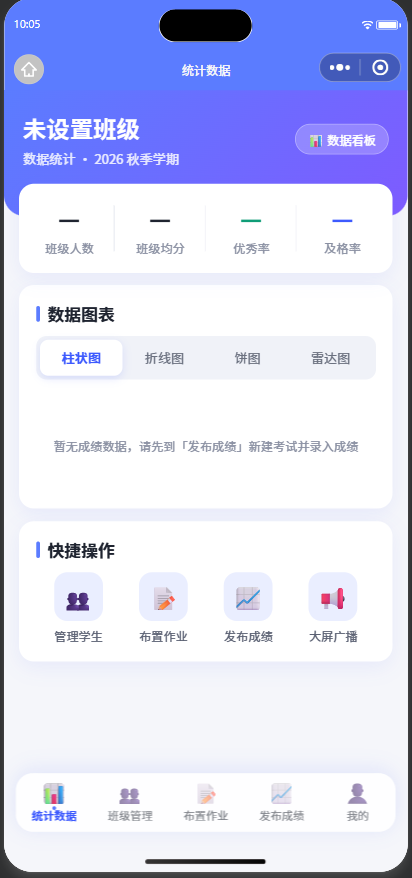
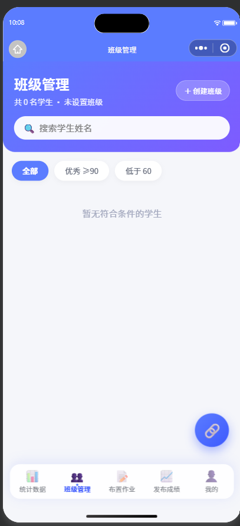
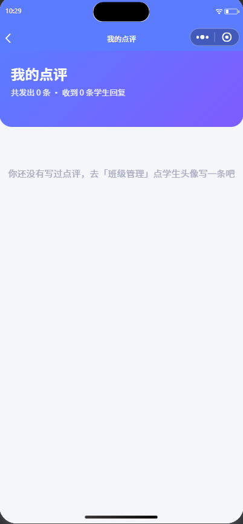
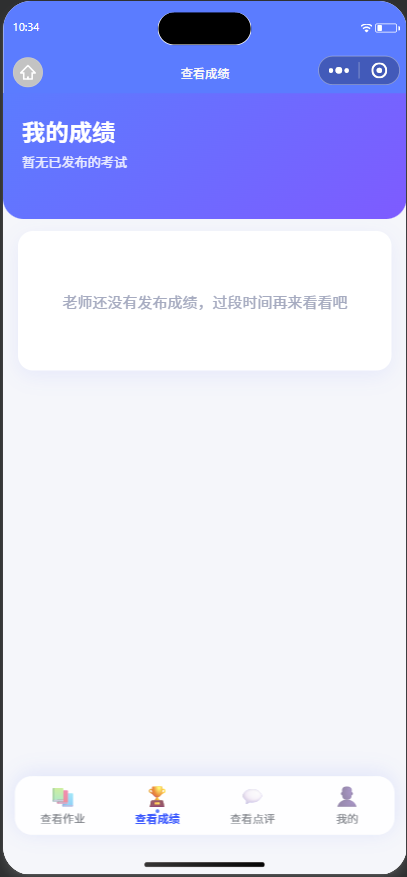
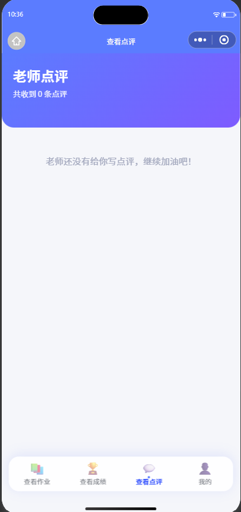
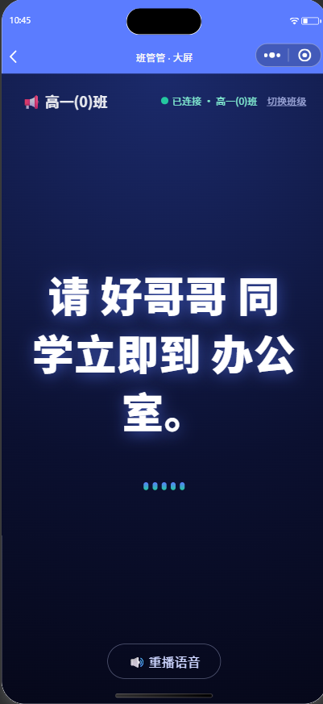

# BanGuanGuan (班管管)

[中文](README.md) | **English**

A WeChat Mini Program for class management: **teachers** assign homework, record and publish scores, write student reviews, and broadcast to a classroom screen; **students** check homework, view scores, receive and reply to reviews.

Built on WeChat Cloud Base (cloud functions + cloud database + cloud storage) — no server of your own required, and all data lives in your own cloud environment.

[](LICENSE)
[](https://developers.weixin.qq.com/miniprogram/dev/framework/)
[](https://developers.weixin.qq.com/miniprogram/dev/wxcloud/basis/getting-started.html)
[](https://github.com/liu-zh-cn/banguanguan/stargazers)

> **Note:** The UI of this mini program is in Chinese. The documentation is bilingual.

## Screenshots

<!-- How to add: WeChat DevTools → Simulator → camera icon (top-right) to export, save into docs/screenshots/ -->

| Teacher · Dashboard | Teacher · Class | Teacher · My Reviews |
| :---: | :---: | :---: |
|  |  |  |
| **Student · Scores** | **Student · Reviews** | **Screen · Broadcast** |
|  |  |  |

## Features

### Teacher

- **Dashboard**: headcount, average score, excellence & pass rates; four charts (per-subject bar chart, exam trend line chart, score distribution pie chart, per-subject radar chart), all computed from real scores in real time
- **Class management**: student roster (with latest average score), one-tap copy of the class invite code, tap a student to write a review (praise / progress / suggestion); teacher team (the head teacher approves joining teachers, removes teachers and transfers ownership)
- **My reviews**: browse all reviews you have written, with student replies highlighted
- **Assign homework**: pick a subject, write the title and requirements, set a due date, watch submission progress (including a late-submission count) live; homework can be withdrawn (student submissions are cleaned up as well)
- **Publish scores**: create an exam (custom subjects supported) → enter per-subject scores → publish / unpublish; students only see published exams
- **Screen broadcast**: push messages to a classroom screen with automatic text-to-speech

### Student

- **Homework**: filter by status (all / to-do / submitted), submit homework online; submissions after the due date are allowed but marked "late"
- **Scores**: total, average, class rank; per-subject comparison with the class average and per-subject rank; switch between past exams
- **Reviews**: timeline of teacher reviews; **reply to your teacher** (replies can be edited)
- **Me**: class rank / pending homework / received reviews at a glance; edit profile, join a class with an invite code

### Misc

- Login: automatic identity via WeChat `openid`, no username or password
- Classroom screen (`screen` page): binds to a class with the invite code and polls for broadcasts starting at 5 seconds (backing off to 30 seconds while idle) with voice playback

## Project Structure

```
├── app.js                 # Cloud-function wrappers + global state
├── app.json               # Page routes
├── pages/
│   ├── index / login / register / edit-profile / setting / create-class
│   ├── privacy            # Privacy policy + user agreement
│   ├── screen             # Big screen (polling broadcast + TTS)
│   ├── teacher/           # stats dashboard / class roster / homework-assign
│   │                      # score-publish / score-input / broadcast
│   │                      # reviews (incl. student replies) / mine
│   └── student/           # homework / score / review / mine
├── components/
│   ├── bottom-nav/        # Bottom navigation (teacher / student variants)
│   └── chart/             # Hand-drawn Canvas charts (bar / line / pie / radar)
├── utils/                 # Shared constants / time formatting / unsaved-changes guard
├── assets/                # Images
└── cloudfunctions/        # 28 cloud functions
```

## Getting Started

1. Import the project into WeChat DevTools
2. Enable Cloud Base and set `CLOUD_ENV` at the top of `app.js` to your environment ID
3. In the Cloud Console → Database, create the collections below following *Data Model & Permissions* (permissions and indexes included)
4. For each of the 28 cloud functions under `cloudfunctions/`: right-click → *Upload and Deploy: Cloud Install Dependencies*
5. Compile and run

> **Two most common pitfalls**
> 1. All **12 collections must use "read/write by creator only"** — no exception is needed. The screen reads broadcasts through a cloud function; the frontend never touches the database directly.
> 2. After editing a cloud function you must **re-upload that cloud function** — uploading the mini program alone does not update it.

## Data Model & Permissions

### Collections & permissions

| Collection | Content | Access | Permission |
|------|------|----------|----------|
| `users` | Users (unique `openid`): role / classId (current class) / classIds (classes a teacher joined) / pending application / name / student no. / gender / signature / subject / title | cloud functions only | read/write by creator only |
| `classes` | Class: name, grade, motto, 6-char invite code (confusable characters removed), `ownerOpenid` (head teacher) | cloud functions only | read/write by creator only |
| `homeworks` | One homework assignment | cloud functions only | read/write by creator only |
| `submissions` | One student's submission of one assignment | cloud functions only | read/write by creator only |
| `exams` | One exam: name, date, subject list, full score, published flag | cloud functions only | read/write by creator only |
| `scores` | One student's scores of one exam: `scores` is `{subject: score}` | cloud functions only | read/write by creator only |
| `reviews` | One teacher review (with student reply `reply` / `replyTs`) | cloud functions only | read/write by creator only |
| `broadcasts` | Screen broadcast messages | cloud functions only | read/write by creator only |
| `code_fails` | Rate-limit records for consecutive wrong invite codes (auto-cleaned) | cloud functions only | read/write by creator only |
| `tts_cache` | MD5 of spoken text → cloud-storage fileID; each text is synthesized only once | cloud functions only | read/write by creator only |
| `rate_limits` | Generic rate-limit counters (`tts` / `sendBroadcast`), bucketed per minute, cleaned by timer | cloud functions only | read/write by creator only |
| `class_stats` | 30-second dashboard cache: `classId → computed result`; invalidated on score entry / exam creation / class transfer / exam deletion | cloud functions only | read/write by creator only |

> **Why the strictest permission still works**
> Cloud functions run with admin privileges and **bypass collection permission rules entirely**. Every read/write in this project happens inside cloud functions (the screen included: the `getBroadcast` function reads broadcasts while the page only polls it), so all 12 collections can safely use "read/write by creator only".

### Suggested indexes

Without indexes everything still works at small scale, but indexes cut scans significantly. Add these in Cloud Console → Database → Index Management:

| Collection | Field | Type | Purpose |
|------|------|------|------|
| `users` | `openid` | **unique (required)** | Locates the current user everywhere; **the unique index is also what makes register's concurrent-dedup work** — without it, concurrent registrations can create duplicate user documents |
| `classes` | `inviteCode` | **unique (required)** | Look up class by code; uniqueness guarantees no two classes share a code |
| `users` | `classId` | normal | Class roster queries |
| `users` | `classIds` | normal | A teacher's class memberships / owner-side pending & teacher queries |
| `homeworks` | `classId + ts` | compound | Homework list, newest first |
| `exams` | `classId + ts` | compound | Exam list / trend chart ordering |
| `scores` | `examId` | normal | All scores of one exam |
| `scores` | `studentOpenid` | normal | A student's own scores |
| `reviews` | `teacherOpenid` / `studentOpenid` | normal | Review lists |
| `broadcasts` | `classId + ts` | compound | Latest broadcast for the screen |
| `code_fails` | `key` | unique | Rate-limit record lookup |
| `rate_limits` | `ts` | normal | Timer cleanup of expired counters |

## Cloud Functions (28)

| Group | Function | Responsibility |
|------|--------|------|
| Account | `login` | Get openid, check registration |
| | `register` | First-time registration / profile update (**role rules below**) |
| | `updateProfile` | Update profile with a server-side field whitelist |
| | `myClass` | Current user + class + roster + teacher team / pending applications (roster & invite code returned to teachers only) |
| Class | `createClass` | Create a class, generate a collision-checked unique invite code (at most 10 classes per teacher) |
| | `joinClass` | Student joins a class by invite code |
| | `applyJoinClass` | Teacher applies to join a class by invite code, awaiting owner approval |
| | `manageTeachers` | Owner approves teacher requests / removes teachers / transfers ownership |
| | `switchClass` | A teacher with multiple classes switches the current class |
| | `getClassByCode` | Screen resolves a class by invite code (read-only) |
| Homework | `assignHomework` | Assign homework |
| | `listHomework` | Homework list (teachers get submission progress, students get their own status) |
| | `submitHomework` | Student submits homework |
| | `deleteHomework` | Withdraw homework and clean up submissions |
| Exams / Scores | `createExam` | Create an exam (with subject list) |
| | `deleteExam` | Delete an exam that has no scores and is unpublished (owner only) |
| | `listExams` | Exam list (teachers get averages and score counts) |
| | `inputScores` | Upsert per-student per-subject scores |
| | `getExamScores` | Input page data: exam + roster + entered scores |
| | `setExamPublished` | Publish / unpublish scores |
| | `myScores` | Student's own scores, class averages, ranks |
| | `classStats` | Dashboard: overview + 4 charts + per-student latest average (30s cache) |
| Reviews | `addReview` | Teacher writes a review |
| | `listReviews` | Review list (by role) |
| | `replyReview` | Student replies to a received review (own reviews only, editable) |
| Screen | `sendBroadcast` | Send a broadcast (class taken from the sender) |
| | `getBroadcast` | Screen gets the latest broadcast by invite code (starts at 5s, backs off to 30s when idle) |
| | `tts` | Text-to-speech: caches audio by text MD5, cross-instance rate limiting, timer cleanup of audio older than 30 days |

### Security design

- **Roles come from the server-side `users` collection** — a `role` sent by the frontend is never trusted. Every teacher-only action (score entry, exam creation, publishing, homework assignment, reviews, dashboard, broadcast) checks `user.role === 'teacher'`; students get "teacher only" errors. Students therefore cannot modify their own scores.
- **Invite-code rate limiting**: `getClassByCode` / `joinClass` / `getBroadcast` share `_invite-guard.js` (duplicated per function since cloud functions deploy independently). **5 wrong attempts within 10 minutes lock the openid for 15 minutes**; success resets the counter. `getBroadcast` is guarded too — otherwise it could be brute-forced directly, bypassing the other two. To unlock manually, set `blockedUntil` to `0` in the matching `code_fails` record.
- **Register role rules**: existing students stay students forever (no privilege escalation via re-registering); existing users only update their profile; first-time registration uses the frontend choice, defaulting to teacher.
- **Trust model (read this)**: the teacher role has **no approval workflow by default** — any WeChat user can self-register as a teacher and create a class. Isolation is per class: a self-proclaimed teacher only sees data of the class they created and of students who voluntarily joined with the invite code. This fits an internal class tool's trust assumptions (codes are handed out by the real teacher in person) and is **not suited to adversarial settings**; if someone impersonates a teacher, rebuild the class to rotate the invite code.
- **Optional teacher approval gate**: setting the environment variable `REQUIRE_TEACHER_APPROVAL=1` on the `createClass` function makes class creation require `users.verifiedTeacher === true`. It stays off by default so the self-service flow is unchanged; when enabled, an administrator flips `verifiedTeacher: true` on approved teachers in the database.
- **A class can have multiple teachers**: `users.classIds` holds the classes a teacher belongs to (membership), `users.classId` is the *current* class (every teacher-facing function reads only this), and `classes.ownerOpenid` is the head teacher (owner). Students still belong to exactly one class.
- **Joining requires owner approval**: a teacher calling `applyJoinClass` with the invite code only writes `applyClassId` (pending); `classId` stays untouched, so until approved they cannot read any students / scores / homework of that class. The owner approves or rejects from the class page via `manageTeachers`.
- **Owner-only actions**: approving / rejecting teachers, removing teachers, transferring ownership, and deleting exams. Every other teaching action (score entry, publishing, assigning / withdrawing homework, reviews, broadcast, dashboard) is shared by all teachers of the class.
- **Switching classes**: `switchClass` only accepts a class in `classIds`; switching simply rewrites `users.classId`, and all other teacher-facing functions follow the current class, so classes never leak into each other. When the owner removes a teacher, their current class falls back to the first remaining one.
- **Class creation rules**: a teacher manages at most 10 classes at a time; creating a new class no longer overwrites the old one (it stays in `classIds` and remains accessible), which is why the old `needForce` confirmation is gone.
- **sendBroadcast rate limiting**: one teacher can send at most 6 broadcasts per minute; counters live in `rate_limits`, work across function instances, and return `code: RATE_LIMITED` when exceeded — a compromised account cannot flood the screen.
- **tts rate limiting & caching**: the `tts` function has no login identity to check (screen devices may be unregistered), so it keeps counters in the `rate_limits` collection for **cross-instance** limiting (6 syntheses per openid per minute, even with multiple function instances) to protect the Baidu TTS endpoint and cloud storage from scripted abuse. Audio is cached as `tts/<md5>.mp3` and recorded in `tts_cache`, so repeating the same text no longer calls the third-party endpoint or takes extra storage.
- **updateProfile field whitelist**: teachers may edit `name / gender / title / subject / signature / className`; students may edit `name / gender / studentNo / signature`. `openid`, `role` and `classId` are always ignored. Empty string deletes the field; omitted fields keep their values. **No phone number or other contact info is collected in this version.**
- **Text length caps**: homework title 100, homework requirement 2000, student submission 2000, review 500, student reply 200, broadcast 200, TTS 200 characters. The server truncates or rejects; the frontend only shows hints.
- **Data isolation**: `myClass` returns the roster to teachers only (students always get an empty `students` list and a class object without the invite code); pending teachers and teachers outside the class get an empty `class` object; `getExamScores` / `classStats` and other whole-class endpoints require `role === 'teacher'` and stay scoped to the current class; students only ever read their own scores and reviews.
- **Privacy consent**: no phone number or other contact info is collected in this version; the registration page has a mandatory "I have read and agree to the User Agreement and Privacy Policy" checkbox including a statement that minors have guardian consent. See `pages/privacy/`.
- **Demo login** (`quickDemo`) only appears in **develop / trial versions** — decided by `wx.getAccountInfoSync().miniProgram.envVersion`; the whole entry is hidden in `release`. It bypasses WeChat identity checks and must stay disabled in production.

## Notes

- Voice playback uses the **Baidu Translate TTS endpoint** (`fanyi.baidu.com/gettts`) — an unofficial API with no availability guarantee; replace the URL inside the `tts` function if it breaks. An older Youdao endpoint returned HTTP 500 for Chinese and was dropped. Max 200 characters per synthesis.
- Audio from `tts` is uploaded to the `tts/` directory, named by text MD5 and recorded in `tts_cache`. A timer trigger in `tts/config.json` runs daily at 04:00 and deletes audio plus cache records older than 30 days (keep the trigger config when uploading the `tts` function). **Audio uploaded by older versions (`timestamp_random.mp3`) is not in `tts_cache`; clean it once manually in the cloud storage console after upgrading. If you manually delete the new cached files under `tts/`, clear the `tts_cache` collection too, otherwise the cache will point to deleted audio.**
- Default subjects are six (Chinese / Math / English / Physics / Chemistry / Biology); a new exam accepts custom subjects separated by commas or 、.
- The "latest score" in the roster is the average of the most recent exam; shows "—" before any score is entered.
- **Statistics caliber**: the class average uses **all recorded scores** of the most recent exam; the excellence / pass rates count **per-student averages**. Absent students and "not entered yet" both currently show as "not participating" and stay out of the denominator (the page states this explicitly).
- **Full score**: on the "Publish scores" page you can pick 100 / 120 / 150 / 200 (default 150, auto-following the most recent exam); it is stored in `exams.fullScore` at exam creation. Input validation (0 ≤ score ≤ full score), bar & radar chart Y axes, detail progress bars, excellence (90%) and pass (60%) rates, and the class-page excellent / at-risk filters are all scaled by it. Old exams without the field fall back to 100. Not editable after creation.
- List queries now fetch in batches: up to 1000 students, 500 homework / exam / review rows, and 200 exams in the student exam switcher. When a cap is hit the response carries `truncated: true` and the page shows "showing the latest N only" instead of silently dropping data.
- **Class size has a single source**: the real headcount always comes from the `users` table; `classes.expectedCount` only stores the "expected size" the teacher typed at creation and is displayed on the class and create-class pages. The old `classes.studentCount` field is no longer maintained.
- **Deleting an exam**: only exams that are **unpublished and have no scores** can be deleted, and only the **head teacher (owner)** gets the entry; once a score exists the entry disappears for everyone and the server refuses as well, so student scores cannot vanish silently.
- **Teacher join & switching**: a teacher can have only one pending application at a time (applying again overwrites it); when approved while already teaching another class, the current class is not force-switched — they switch from the "Create class" page themselves. A teacher manages at most 10 classes.
- **Unsaved-changes guard**: leaving the edit-profile / assign-homework / create-class pages after edits pops a "not saved yet" confirmation; saving or publishing clears it. It is skipped silently below base library 2.12.0.
- **No fake default profile**: fields a new account never filled show "not set" instead of placeholder names such as "刘同学 / 李老师".
- **Search indexing**: `sitemap.json` is set to `disallow *` — an internal class tool should not be indexed by WeChat.

## Suggested regression checklist

After changing cloud functions, focus on these:

- [ ] Teacher: create exam → enter scores → publish → student sees them
- [ ] Student: try a teacher action → "teacher only" error appears
- [ ] Edit profile: rename → kill and restart the mini program → the name persists (`updateProfile` deployed)
- [ ] Edit profile: no phone field is shown (removed in this version); the class field is read-only
- [ ] Score entry: **clear a score → save → switch subject and back → still empty**
- [ ] Release build: the login page shows no "demo login"
- [ ] Screen: status shows "connected", and does **not** replay the previous broadcast; a new broadcast appears within 5 seconds (up to 30 seconds after idle back-off)
- [ ] Invite code: 5 wrong attempts → "too many attempts" toast
- [ ] Full score: create a 150-point exam → entering 160 is rejected → chart axes, progress bars and the "excellent" filter scale by 150
- [ ] Withdraw homework: it disappears from the list and student submissions are deleted
- [ ] Due date: set it to yesterday → the student sees "expired / submit late" → after submitting, "late" appears for the student and the teacher's progress shows "late 1"
- [ ] TTS cache: send the same broadcast twice → the second one skips Baidu (`tts_cache` hit) and cloud storage keeps a single file
- [ ] Broadcast rate limit: send 7 messages within a minute → the 7th is rejected as "too frequent"
- [ ] Delete exam: a new empty exam can be deleted; after entering one score the entry disappears and a forced call is refused; a non-owner teacher never sees the delete button
- [ ] Form guard: change one character in edit-profile then go back → "not saved" prompt; after saving it no longer prompts
- [ ] Default profile: a fresh account shows no sample name / signature on "Me"
- [ ] Dashboard cache: enter scores then open stats immediately → numbers are fresh (writes invalidate the cache)
- [ ] Review reply: student replies → teacher sees the highlighted reply under "Me → My reviews" → student edits the reply and the teacher side updates
- [ ] Multiple teachers: teacher B applies with the code → B sees no class data yet → owner A sees the pending request on the class page → after approval B can see the roster and scores
- [ ] Remove teacher: A removes B → B's class page shows no students of that class and score entry is refused
- [ ] Transfer ownership: A transfers to B → A loses the approve / delete entries and B gains them
- [ ] Switching classes: one teacher in two classes → after switching, roster / scores / homework all follow the new class
- [ ] Screen: bind, background the app for 30s, have the teacher send a broadcast → returning to the screen page should speak the new broadcast automatically
- [ ] "Me" page stats: class rank / pending homework / received reviews show real numbers

## Known limitations

- **Screen is polling, not push**: the `screen` page starts at one `getBroadcast` call every 5 seconds and backs off to 30 seconds while no new broadcast arrives, returning to 5 seconds as soon as one appears; polling stops automatically while the page is hidden (`onHide`) to save cloud-function calls. The trade-off is up to 30 seconds of latency when idle.
- **Bottom navigation uses `reLaunch` instead of the native tabBar**: teacher (5) and student (4) pages have different paths while the native tabBar list is global and capped at 5 entries, so both sets cannot coexist; moving to `custom-tab-bar` would require merging both sets into container pages — a structural rewrite. The current cost is losing the page stack and form state when switching tabs.
- **No automated tests** — regression relies on the checklist above.

## Requirements

- WeChat DevTools (base library 3.16.3+; the unsaved-changes guard needs 2.12.0+)
- Cloud Base enabled (cloud functions + cloud database + cloud storage)

## Tech Stack

Native mini program (no framework, no build step) + WeChat Cloud Base. Charts are hand-drawn on Canvas with no third-party chart library; a custom `bottom-nav` component works around the 5-tab limit of the native tabBar.

## Disclaimer

This mini program is an internal class-management tool (productivity category), not a content-community / notes product.

## Usage notes

1. All text content (homework, scores, reviews, broadcasts) is published by teachers only and circulates one-way inside a single class; students enter the one and only class via a teacher-generated invite code.
2. Nothing is public: no following, comments, sharing, or feeds; users cannot browse other classes' content.
3. Pages are empty before a class is created or joined — that is expected.

> The Privacy Policy and User Agreement are available inside the mini program (from the registration, edit-profile and settings pages). Data collected: openid (login identifier, auto-generated); name / student no. / class (class-internal identifiers), plus optional gender / signature / subject / teacher title. **No phone number, email or any other contact info is collected**, and no WeChat user-profile, phone, location, camera or album APIs are used.

## Contact

E-MAIL: liu20250115@outlook.com

## Can you promise me one thing before using it?

This project is open source under the MIT license, so you’re free to use, modify, and distribute it. I can’t stop you, and I don’t need to.

But if you really plan to do something with it, I hope you can:

1. **Give it a Star** — it’s the most direct encouragement for the author

2. **Open an Issue to let me know** — so I know where the code is going, and it helps me keep improving it

This isn’t a legal requirement. MIT doesn’t allow extra conditions, so the two points above are just requests. It’s totally legal if you don’t follow them.

I just hope this project won’t be just a bunch of files that nobody looks at.

## License

[MIT](LICENSE) © 2026 Timmy Liu

This project was independently developed by a minor author and is released under the MIT License with the consent of the author's legal guardian.
