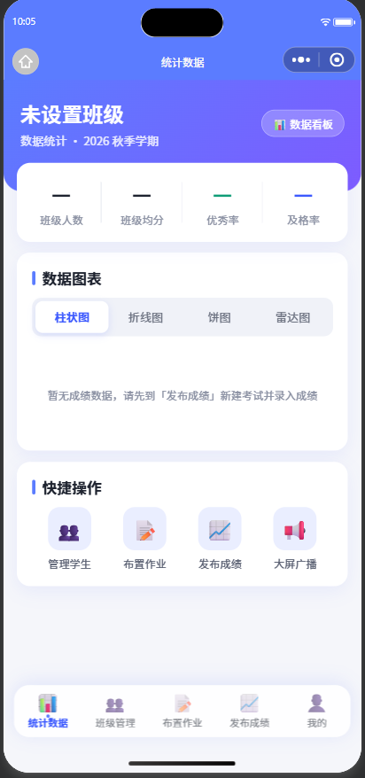
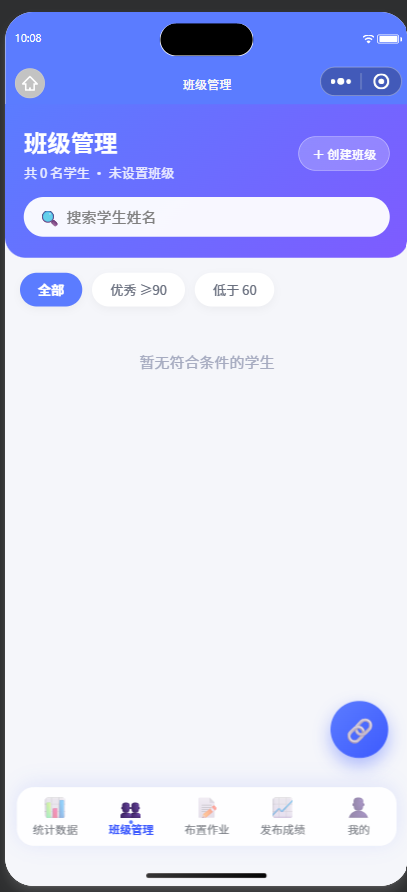
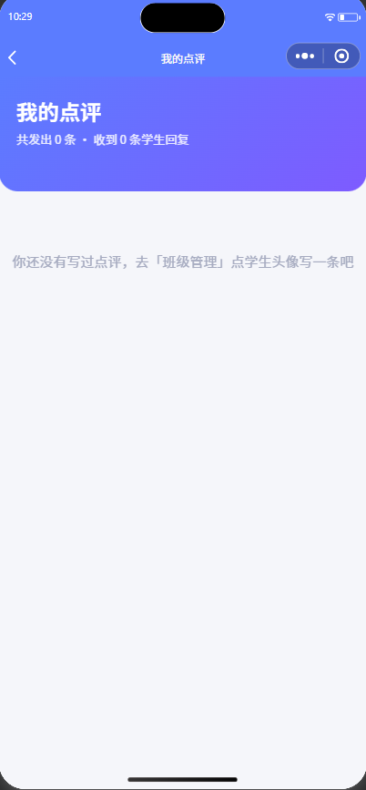
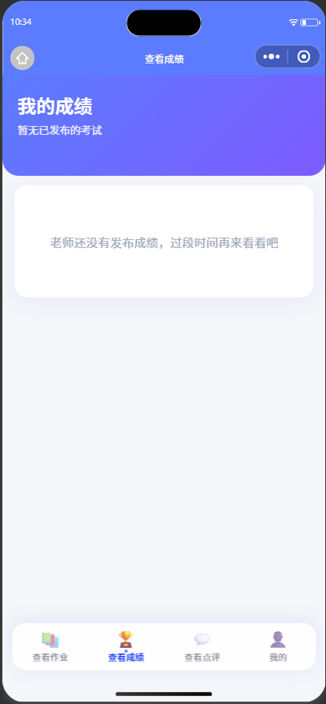
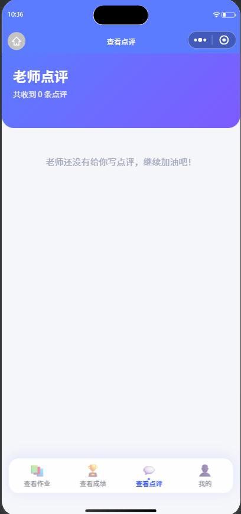
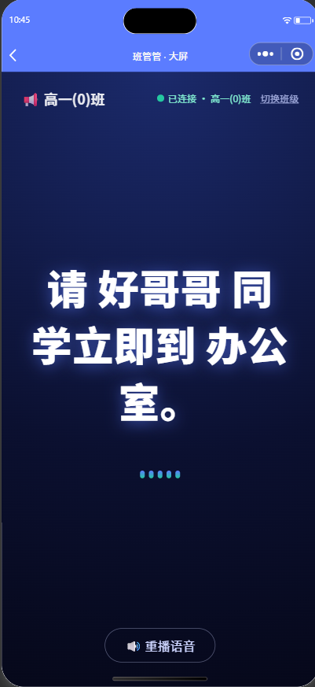

# BanGuanGuan (班管管)

[中文](README.md) | **English**

A WeChat Mini Program for class management: **teachers** assign homework, record and publish scores, write student reviews, and broadcast to a classroom screen; **students** check homework, view scores, receive and reply to reviews.

Built on WeChat Cloud Base (cloud functions + cloud database + cloud storage) — no server of your own required, and all data lives in your own cloud environment.

[](LICENSE)
[](https://developers.weixin.qq.com/miniprogram/dev/framework/)
[](https://developers.weixin.qq.com/miniprogram/dev/wxcloud/basis/getting-started.html)
[](https://github.com/liu-zh-cn/banguanguan/stargazers)

> **Note:** The UI of this mini program is in Chinese. The documentation is bilingual.

## Screenshots

<!-- How to add: WeChat DevTools → Simulator → camera icon (top-right) to export, save into docs/screenshots/ -->

| Teacher · Dashboard | Teacher · Class | Teacher · My Reviews |
| :---: | :---: | :---: |
|  |  |  |
| **Student · Scores** | **Student · Reviews** | **Screen · Broadcast** |
|  |  |  |

## Features

### Teacher

- **Dashboard**: headcount, average score, excellence & pass rates; four charts (per-subject bar chart, exam trend line chart, score distribution pie chart, per-subject radar chart), all computed from real scores in real time
- **Class management**: student roster (with latest average score), one-tap copy of the class invite code, tap a student to write a review (praise / progress / suggestion)
- **My reviews**: browse all reviews you have written, with student replies highlighted
- **Assign homework**: pick a subject, write the title and requirements, set a due date, watch submission progress live; homework can be withdrawn (student submissions are cleaned up as well)
- **Publish scores**: create an exam (custom subjects supported) → enter per-subject scores → publish / unpublish; students only see published exams
- **Screen broadcast**: push messages to a classroom screen with automatic text-to-speech

### Student

- **Homework**: filter by status (all / to-do / submitted), submit homework online
- **Scores**: total, average, class rank; per-subject comparison with the class average and per-subject rank; switch between past exams
- **Reviews**: timeline of teacher reviews; **reply to your teacher** (replies can be edited)
- **Me**: class rank / pending homework / received reviews at a glance; edit profile, join a class with an invite code

### Misc

- Login: automatic identity via WeChat `openid`, no username or password
- Classroom screen (`screen` page): binds to a class with the invite code and polls for broadcasts every 5 seconds with voice playback

## Project Structure

```
├── app.js                 # Cloud-function wrappers + global state
├── app.json               # Page routes
├── pages/
│   ├── index / login / register / edit-profile / setting / create-class
│   ├── privacy            # Privacy policy + user agreement
│   ├── screen             # Big screen (polling broadcast + TTS)
│   ├── teacher/           # stats dashboard / class roster / homework-assign
│   │                      # score-publish / score-input / broadcast
│   │                      # reviews (incl. student replies) / mine
│   └── student/           # homework / score / review / mine
├── components/
│   ├── bottom-nav/        # Bottom navigation (teacher / student variants)
│   └── chart/             # Hand-drawn Canvas charts (bar / line / pie / radar)
├── assets/                # Images
└── cloudfunctions/        # 24 cloud functions
```

## Getting Started

1. Import the project into WeChat DevTools
2. Enable Cloud Base and set `CLOUD_ENV` at the top of `app.js` to your environment ID
3. In the Cloud Console → Database, create the collections below following *Data Model & Permissions* (permissions and indexes included)
4. For each of the 24 cloud functions under `cloudfunctions/`: right-click → *Upload and Deploy: Cloud Install Dependencies*
5. Compile and run

> **Two most common pitfalls**
> 1. All **9 collections must use "read/write by creator only"** — no exception is needed. The screen reads broadcasts through a cloud function; the frontend never touches the database directly.
> 2. After editing a cloud function you must **re-upload that cloud function** — uploading the mini program alone does not update it.

## Data Model & Permissions

### Collections & permissions

| Collection | Content | Access | Permission |
|------|------|----------|----------|
| `users` | Users (unique `openid`): role / classId / name / student no. / subject / contact (phone is teacher-only, optional) | cloud functions only | read/write by creator only |
| `classes` | Class: name, grade, motto, 6-char invite code (confusable characters removed) | cloud functions only | read/write by creator only |
| `homeworks` | One homework assignment | cloud functions only | read/write by creator only |
| `submissions` | One student's submission of one assignment | cloud functions only | read/write by creator only |
| `exams` | One exam: name, date, subject list, full score, published flag | cloud functions only | read/write by creator only |
| `scores` | One student's scores of one exam: `scores` is `{subject: score}` | cloud functions only | read/write by creator only |
| `reviews` | One teacher review (with student reply `reply` / `replyTs`) | cloud functions only | read/write by creator only |
| `broadcasts` | Screen broadcast messages | cloud functions only | read/write by creator only |
| `code_fails` | Rate-limit records for consecutive wrong invite codes (auto-cleaned) | cloud functions only | read/write by creator only |

> **Why the strictest permission still works**
> Cloud functions run with admin privileges and **bypass collection permission rules entirely**. Every read/write in this project happens inside cloud functions (the screen included: the `getBroadcast` function reads broadcasts while the page only polls it), so all 9 collections can safely use "read/write by creator only".

### Suggested indexes

Without indexes everything still works at small scale, but indexes cut scans significantly. Add these in Cloud Console → Database → Index Management:

| Collection | Field | Type | Purpose |
|------|------|------|------|
| `users` | `openid` | **unique (required)** | Locates the current user everywhere; **the unique index is also what makes register's concurrent-dedup work** — without it, concurrent registrations can create duplicate user documents |
| `classes` | `inviteCode` | **unique (required)** | Look up class by code; uniqueness guarantees no two classes share a code |
| `users` | `classId` | normal | Class roster queries |
| `homeworks` | `classId + ts` | compound | Homework list, newest first |
| `exams` | `classId + ts` | compound | Exam list / trend chart ordering |
| `scores` | `examId` | normal | All scores of one exam |
| `scores` | `studentOpenid` | normal | A student's own scores |
| `reviews` | `teacherOpenid` / `studentOpenid` | normal | Review lists |
| `broadcasts` | `classId + ts` | compound | Latest broadcast for the screen |
| `code_fails` | `key` | unique | Rate-limit record lookup |

## Cloud Functions (24)

| Group | Function | Responsibility |
|------|--------|------|
| Account | `login` | Get openid, check registration |
| | `register` | First-time registration / profile update (**role rules below**) |
| | `updateProfile` | Update profile with a server-side field whitelist |
| | `myClass` | Current user + class + roster (roster & invite code returned to teachers only) |
| Class | `createClass` | Create a class, generate a collision-checked unique invite code |
| | `joinClass` | Student joins a class by invite code |
| | `getClassByCode` | Screen resolves a class by invite code (read-only) |
| Homework | `assignHomework` | Assign homework |
| | `listHomework` | Homework list (teachers get submission progress, students get their own status) |
| | `submitHomework` | Student submits homework |
| | `deleteHomework` | Withdraw homework and clean up submissions |
| Exams / Scores | `createExam` | Create an exam (with subject list) |
| | `listExams` | Exam list (teachers get averages and score counts) |
| | `inputScores` | Upsert per-student per-subject scores |
| | `getExamScores` | Input page data: exam + roster + entered scores |
| | `setExamPublished` | Publish / unpublish scores |
| | `myScores` | Student's own scores, class averages, ranks |
| | `classStats` | Dashboard: overview + 4 charts + per-student latest average |
| Reviews | `addReview` | Teacher writes a review |
| | `listReviews` | Review list (by role) |
| | `replyReview` | Student replies to a received review (own reviews only, editable) |
| Screen | `sendBroadcast` | Send a broadcast (class taken from the sender) |
| | `getBroadcast` | Screen gets the latest broadcast by invite code (5s polling) |
| | `tts` | Text-to-speech, upload to cloud storage, return fileID |

### Security design

- **Roles come from the server-side `users` collection** — a `role` sent by the frontend is never trusted. Every teacher-only action (score entry, exam creation, publishing, homework assignment, reviews, dashboard, broadcast) checks `user.role === 'teacher'`; students get "teacher only" errors. Students therefore cannot modify their own scores.
- **Invite-code rate limiting**: `getClassByCode` / `joinClass` / `getBroadcast` share `_invite-guard.js` (duplicated per function since cloud functions deploy independently). **5 wrong attempts within 10 minutes lock the openid for 15 minutes**; success resets the counter. `getBroadcast` is guarded too — otherwise it could be brute-forced directly, bypassing the other two. To unlock manually, set `blockedUntil` to `0` in the matching `code_fails` record.
- **Register role rules**: existing students stay students forever (no privilege escalation via re-registering); existing users only update their profile; first-time registration uses the frontend choice, defaulting to teacher.
- **Trust model (read this)**: the teacher role has **no approval workflow** — any WeChat user can self-register as a teacher and create a class. Isolation is per class: a self-proclaimed teacher only sees data of the class they created and of students who voluntarily joined with the invite code. This fits an internal class tool's trust assumptions (codes are handed out by the real teacher in person) and is **not suited to adversarial settings**; if someone impersonates a teacher, rebuild the class to rotate the invite code.
- **Re-create-class guard**: when the teacher already has a class, `createClass` rejects with `needForce`; the frontend asks for explicit confirmation ("the old class will no longer be managed by you") before rebuilding, preventing accidental orphan classes.
- **tts rate limiting**: the `tts` function has no login identity to check (screen devices may be unregistered), so it applies a light per-openid limit of 6 syntheses per minute per instance to protect the Baidu TTS endpoint and cloud storage from scripted abuse.
- **updateProfile field whitelist**: teachers may edit `name / gender / phone / title / subject / signature / className`; students may edit `name / gender / studentNo / signature` (**no phone number is collected from students**). `openid`, `role` and `classId` are always ignored. Empty string deletes the field; omitted fields keep their values.
- **Data isolation**: `myClass` returns the roster to teachers only (students always get an empty `students` list and a class object without the invite code); `getExamScores` / `classStats` and other whole-class endpoints require `role === 'teacher'`; students only ever read their own scores and reviews.
- **Privacy consent**: the phone number is collected from teachers only, with an explicit opt-in switch; the registration page has a mandatory "I have read and agree to the User Agreement and Privacy Policy" checkbox including a statement that minors have guardian consent. See `pages/privacy/`.
- **Demo login** (`quickDemo`) only appears in **develop / trial versions** — decided by `wx.getAccountInfoSync().miniProgram.envVersion`; the whole entry is hidden in `release`. It bypasses WeChat identity checks and must stay disabled in production.

## Notes

- Voice playback uses the **Baidu Translate TTS endpoint** (`fanyi.baidu.com/gettts`) — an unofficial API with no availability guarantee; replace the URL inside the `tts` function if it breaks. An older Youdao endpoint returned HTTP 500 for Chinese and was dropped. Max 200 characters per synthesis.
- Audio from `tts` is uploaded to the `tts/` directory in cloud storage — watch cleanup and quota for long-term use.
- Default subjects are six (Chinese / Math / English / Physics / Chemistry / Biology); a new exam accepts custom subjects separated by commas or 、.
- The "latest score" in the roster is the average of the most recent exam; shows "—" before any score is entered.
- **Full score**: on the "Publish scores" page you can pick 100 / 120 / 150 / 200 (default 150, auto-following the most recent exam); it is stored in `exams.fullScore` at exam creation. Input validation (0 ≤ score ≤ full score), bar & radar chart Y axes, detail progress bars, excellence (90%) and pass (60%) rates, and the class-page excellent / at-risk filters are all scaled by it. Old exams without the field fall back to 100. Not editable after creation.
- Several list queries still use `limit` (homework list 100, exam list 50, reviews 100, roster 200 on the score-entry page); exceeding it **silently truncates**. Paginate if your class is much larger. Score statistics (`classStats`) and submission counts (`listHomework`) already fetch in batches and are not affected.

## Suggested regression checklist

After changing cloud functions, focus on these:

- [ ] Teacher: create exam → enter scores → publish → student sees them
- [ ] Student: try a teacher action → "teacher only" error appears
- [ ] Edit profile: rename → kill and restart the mini program → the name persists (`updateProfile` deployed)
- [ ] Edit profile: **clear the phone number → save → re-enter → phone is empty** (deletion really works)
- [ ] Edit profile: students see no phone field; the class field is read-only
- [ ] Score entry: **clear a score → save → switch subject and back → still empty**
- [ ] Release build: the login page shows no "demo login"
- [ ] Screen: status shows "connected", and does **not** replay the previous broadcast; a new broadcast appears within 5 seconds
- [ ] Invite code: 5 wrong attempts → "too many attempts" toast
- [ ] Full score: create a 150-point exam → entering 160 is rejected → chart axes, progress bars and the "excellent" filter scale by 150
- [ ] Withdraw homework: it disappears from the list and student submissions are deleted
- [ ] Review reply: student replies → teacher sees the highlighted reply under "Me → My reviews" → student edits the reply and the teacher side updates
- [ ] Re-create class: with an existing class, tapping "Create class" shows a confirmation warning that the old class will no longer be managed by you
- [ ] Screen: bind, background the app for 30s, have the teacher send a broadcast → returning to the screen page should speak the new broadcast automatically
- [ ] "Me" page stats: class rank / pending homework / received reviews show real numbers

## Known limitations

- **Screen is polling, not push**: the `screen` page calls `getBroadcast` every 5 seconds, so broadcasts may be up to 5 seconds late; polling stops automatically while the page is hidden (`onHide`) to save cloud-function calls. Increase `POLL_MS` in `screen.js` to save more.
- **No automated tests** — regression relies on the checklist above.

## Requirements

- WeChat DevTools (base library 3.0.0+)
- Cloud Base enabled (cloud functions + cloud database + cloud storage)

## Tech Stack

Native mini program (no framework, no build step) + WeChat Cloud Base. Charts are hand-drawn on Canvas with no third-party chart library; a custom `bottom-nav` component works around the 5-tab limit of the native tabBar.

## Disclaimer

This mini program is an internal class-management tool (productivity category), not a content-community / notes product.

## Usage notes

1. All text content (homework, scores, reviews, broadcasts) is published by teachers only and circulates one-way inside a single class; students enter the one and only class via a teacher-generated invite code.
2. Nothing is public: no following, comments, sharing, or feeds; users cannot browse other classes' content.
3. Pages are empty before a class is created or joined — that is expected.

> The Privacy Policy and User Agreement are available inside the mini program (from the registration, edit-profile and settings pages). Data collected: openid (login identifier, auto-generated); name / student no. / class (class-internal identifiers); phone number **collected from teachers only, optional**, with a separate consent checkbox. No WeChat user-profile, phone, location, camera or album APIs are used.

## Contact

E-MAIL: liu20250115@outlook.com

## License

[MIT](LICENSE) © 2026 Timmy Liu

This project was independently developed by a minor author and is released under the MIT License with the consent of the author's legal guardian.
