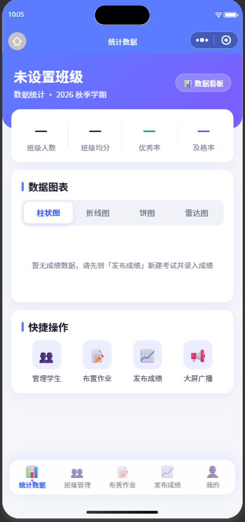
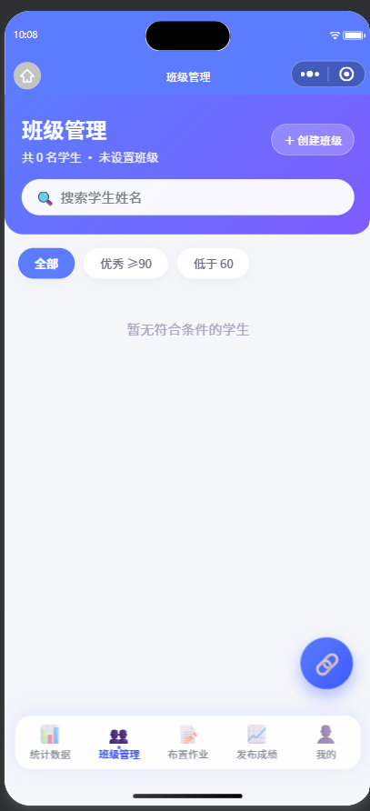
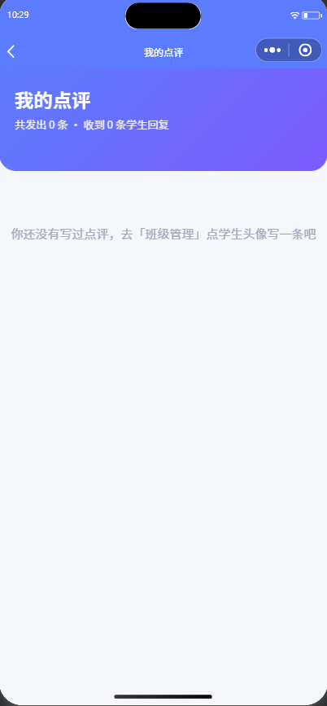
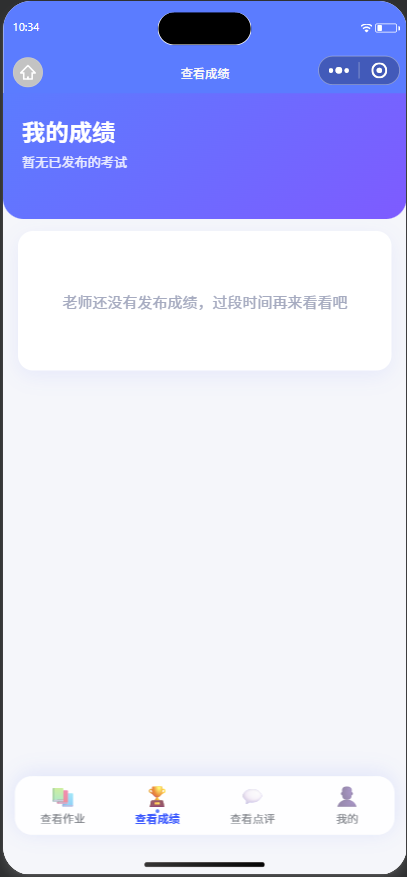
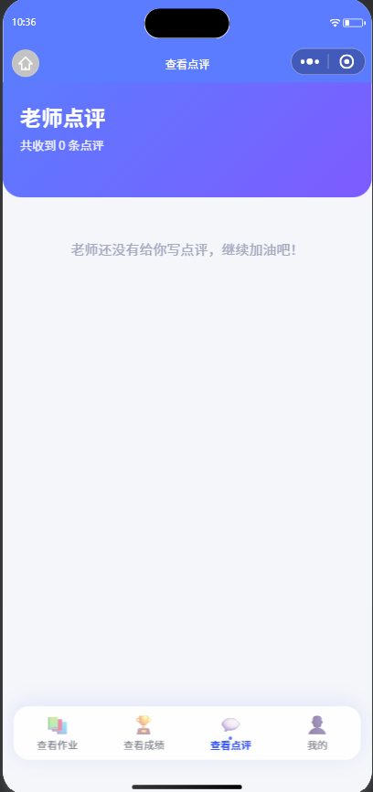
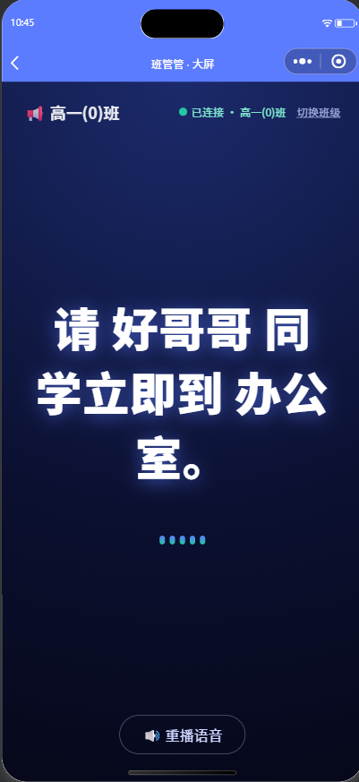

# 班管管

**简体中文** | [English](README.en.md)

一个班级管理微信小程序：**老师**发作业、录成绩、写点评、大屏广播；**学生**查作业、看成绩、收点评、回复老师。

基于微信云开发（云函数 + 云数据库 + 云存储），无需自建服务器，所有数据都在你自己的云环境里。

[](LICENSE)
[](https://developers.weixin.qq.com/miniprogram/dev/framework/)
[](https://developers.weixin.qq.com/miniprogram/dev/wxcloud/basis/getting-started.html)
[](https://github.com/liu-zh-cn/banguanguan/stargazers)

## 截图预览

<!-- 截图方法：微信开发者工具 → 模拟器 → 右上角相机图标导出图片，放入 docs/screenshots/ -->

| 老师端 · 数据看板 | 老师端 · 班级管理 | 老师端 · 我的点评 |
| :---: | :---: | :---: |
|  |  |  |
| **学生端 · 我的成绩** | **学生端 · 老师点评** | **大屏 · 广播** |
|  |  |  |

## 功能一览

### 老师端

- **数据看板**：班级人数、均分、优秀率、及格率；四种图表（各科均分柱状图、考试趋势折线图、成绩分布饼图、各科均分雷达图），全部按真实成绩实时计算
- **班级管理**：学生名单（附最近一次考试的均分）、一键复制班级邀请码、点学生给他写点评（表扬 / 进步 / 建议）
- **我的点评**：查看自己写过的全部点评，学生回复会高亮展示
- **布置作业**：选学科、写标题与要求、设置截止日期，实时查看已交进度，可撤回作业（连带删除学生的提交记录）
- **发布成绩**：新建考试（可自定义科目）→ 录入各科成绩 → 发布 / 撤回；学生端只能看到已发布的成绩
- **大屏广播**：把消息推到大屏，自动语音播报

### 学生端

- **查看作业**：按状态筛选（全部 / 待完成 / 已提交），可在线提交作业
- **查看成绩**：总分、平均分、班级排名；单科与班级均分对比、单科排名，可切换历次考试
- **查看点评**：时间线查看老师点评，可**回复老师**（支持修改自己的回复）
- **我的**：班级排名、待交作业、收到点评三个统计项；修改资料、凭邀请码加入班级

### 通用

- 注册 / 登录：微信身份（openid）自动识别，无需账号密码
- 大屏（screen 页）：凭邀请码绑定班级，轮询接收老师广播并语音播报（5 秒起步，无消息退避至 30 秒）

## 目录结构

```
├── app.js                 # 云函数调用封装 + 全局状态
├── app.json               # 页面路由
├── pages/
│   ├── index / login / register / edit-profile / setting / create-class
│   ├── privacy            # 隐私政策 + 用户服务协议
│   ├── screen             # 大屏（轮询广播 + 语音播报）
│   ├── teacher/           # stats 统计 / class 班级 / homework-assign 布置作业
│   │                      # score-publish 发布成绩 / score-input 录入成绩 / broadcast 广播
│   │                      # reviews 我的点评（含学生回复）/ mine 我的
│   └── student/           # homework 作业 / score 成绩 / review 点评 / mine 我的
├── components/
│   ├── bottom-nav/        # 底部导航（老师 / 学生两套）
│   └── chart/             # 纯 Canvas 手绘图表（柱状/折线/环形/雷达）
├── utils/                 # 公共常量 / 时间格式化 / 离开页保护
├── assets/                # 图片资源
└── cloudfunctions/        # 25 个云函数
```

## 快速开始

1. 用微信开发者工具导入本项目
2. 开通云开发环境，把 `app.js` 顶部 `CLOUD_ENV` 改成自己的环境 ID
3. 云开发控制台 → 数据库，按下面的《数据模型与权限》新建集合、配置权限和索引
4. `cloudfunctions/` 下 25 个云函数，逐个右键 →「上传并部署：云端安装依赖」
5. 编译运行

> **最容易踩的两个坑**
> 1. **12 个集合全部选「仅创建者可读写」**，不需要为任何集合放开权限。大屏读广播走的是云函数，不依赖前端直连数据库。
> 2. 改了云函数代码必须**重新上传云函数**，不是只上传小程序。前端改动跟着体验版 / 正式版走，云函数不会自动更新。

## 数据模型与权限

### 集合与权限

| 集合 | 内容 | 访问方式 | 权限设置 |
|------|------|----------|----------|
| `users` | 用户（openid 唯一）：role / classId / 姓名 / 学号 / 性别 / 个性签名 / 学科 / 职务 | 仅云函数 | 仅创建者可读写 |
| `classes` | 班级：名称、年级、座右铭、6 位邀请码（已剔除易混字符） | 仅云函数 | 仅创建者可读写 |
| `homeworks` | 一次作业 | 仅云函数 | 仅创建者可读写 |
| `submissions` | 一位学生对一次作业的提交 | 仅云函数 | 仅创建者可读写 |
| `exams` | 一次考试：名称、日期、科目列表、试卷满分、是否发布 | 仅云函数 | 仅创建者可读写 |
| `scores` | 一位学生一次考试的成绩：`scores` 字段是 `{科目: 分数}` | 仅云函数 | 仅创建者可读写 |
| `reviews` | 一条老师点评（含学生回复 `reply` / `replyTs`） | 仅云函数 | 仅创建者可读写 |
| `broadcasts` | 大屏广播消息 | 仅云函数 | 仅创建者可读写 |
| `code_fails` | 邀请码连续输错的限流记录（成功验证即清理，无需维护） | 仅云函数 | 仅创建者可读写 |
| `tts_cache` | 语音文本的 MD5 → 云存储 fileID，同一段文本只合成一次 | 仅云函数 | 仅创建者可读写 |
| `rate_limits` | 通用限流计数（`tts` / `sendBroadcast`），按分钟分桶，定时清理 | 仅云函数 | 仅创建者可读写 |
| `class_stats` | 数据看板 30 秒缓存：`classId → 计算结果`，录成绩 / 建考试 / 转班 / 删考试时失效 | 仅云函数 | 仅创建者可读写 |

> **为什么全部选最严的权限也能用？**
> 云函数走的是管理端权限，**完全绕过集合权限规则**。本项目所有读写都在云函数里（大屏也不例外：`getBroadcast` 云函数读广播，页面只负责轮询），前端不直接碰数据库，所以 12 个集合统一选「仅创建者可读写」即可，不存在需要放开的例外。

### 建议索引

数据量小的时候没索引也能跑，但索引能显著减少扫描。建议在云开发控制台 → 数据库 → 索引管理里加上：

| 集合 | 字段 | 类型 | 用途 |
|------|------|------|------|
| `users` | `openid` | **唯一（必建）** | 所有云函数都靠它定位当前用户；**唯一索引同时是 register 并发去重的依赖**，不建的话并发注册可能产生重复用户文档 |
| `classes` | `inviteCode` | **唯一（必建）** | 凭码查班；唯一约束同时保证不会两个班共用一个码 |
| `users` | `classId` | 普通 | 查班级学生名单 |
| `homeworks` | `classId + ts` | 复合 | 作业列表按时间倒序 |
| `exams` | `classId + ts` | 复合 | 考试列表 / 趋势图排序 |
| `scores` | `examId` | 普通 | 一次考试的全部成绩 |
| `scores` | `studentOpenid` | 普通 | 学生查自己的成绩 |
| `reviews` | `teacherOpenid` / `studentOpenid` | 普通 | 点评列表 |
| `broadcasts` | `classId + ts` | 复合 | 大屏取最新一条 |
| `code_fails` | `key` | 唯一 | 限流记录查找 |
| `rate_limits` | `ts` | 普通 | 定时清理过期计数 |

## 云函数清单（25 个）

| 分类 | 云函数 | 职责 |
|------|--------|------|
| 账号 | `login` | 取 openid，判断是否已注册 |
| | `register` | 首次注册 / 更新资料（**身份规则见下**） |
| | `updateProfile` | 更新资料，服务端字段白名单 |
| | `myClass` | 当前用户 + 所在班级 + 学生名单（名单与邀请码仅对老师返回） |
| 班级 | `createClass` | 建班，生成查重后的唯一邀请码 |
| | `joinClass` | 学生凭邀请码入班 |
| | `getClassByCode` | 大屏凭邀请码解析班级（只读） |
| 作业 | `assignHomework` | 布置作业 |
| | `listHomework` | 作业列表（老师带已交进度，学生带提交状态） |
| | `submitHomework` | 学生提交作业 |
| | `deleteHomework` | 老师撤回作业，连带清理提交记录 |
| 考试 / 成绩 | `createExam` | 新建考试（含科目列表） |
| | `deleteExam` | 删除没有成绩、未发布的考试 |
| | `listExams` | 考试列表（老师附平均分和成绩条数） |
| | `inputScores` | 按学生逐条 upsert 某科成绩 |
| | `getExamScores` | 录入页数据：考试 + 名单 + 已录成绩 |
| | `setExamPublished` | 发布 / 撤回成绩 |
| | `myScores` | 学生查自己成绩、班级均分、排名 |
| | `classStats` | 数据看板：总览 + 四张图 + 每人最新均分（30 秒缓存） |
| 点评 | `addReview` | 老师写点评 |
| | `listReviews` | 点评列表（按角色返回） |
| | `replyReview` | 学生回复收到的点评（仅本人可回，可修改） |
| 大屏 | `sendBroadcast` | 发广播（班级取发送者本人） |
| | `getBroadcast` | 大屏凭邀请码取本班最新一条广播（5 秒起步，无新消息退避到 30 秒） |
| | `tts` | 文本转语音：按文本 MD5 缓存到云存储，跨实例限流，定时清理 30 天前的音频 |

### 权限设计

- **身份以服务端 `users` 表为准**，不接受前端传的 role。所有老师专属操作（录成绩、建考试、发布、布置作业、写点评、看板、发广播）都会校验 `user.role === 'teacher'`，学生调用直接返回「仅老师可…」。学生因此无法修改自己的分数。
- **invite code 限流**：`getClassByCode` / `joinClass` / `getBroadcast` 共用 `_invite-guard.js`（各存一份，云函数独立打包不能跨目录 require）。同一 openid **10 分钟内错 5 次锁定 15 分钟**，验证成功即清零。`getBroadcast` 也接入了限流——否则绕开前两个函数直接刷它就能无限枚举邀请码。想手动解封，把 `code_fails` 里对应记录的 `blockedUntil` 改成 `0`。
- **register 的身份规则**：已是学生的永远保持学生（不能靠重新注册提权）；已有身份的只更新资料、不改 role；首次注册只接受 `teacher` / `student`，未传默认老师。历史脏数据里的 `admin` 等非法角色会在下次调用 `register` 时归一为老师。
- **信任模型（务必了解）**：默认情况下首次注册的老师身份**没有审核通道**，任何微信用户都可以自封老师并建班。系统的隔离单位是班级——自封老师只能读到「自己创建的班级里、自愿凭邀请码加入的学生」的数据，读不到其他班级。这适合班级内部工具的信任假设（邀请码由真实老师在真实场景分发），**不适合对抗性场景**；若被恶意者冒充老师并把邀请码扩散给学生，请撤换该班邀请码（重建班级）。
- **可选的教师审核闸门**：给 `createClass` 云函数配置环境变量 `REQUIRE_TEACHER_APPROVAL=1` 后，只有 `users.verifiedTeacher === true` 的账号能创建班级。默认不开启，保持现有自助流程；需要审核时，由管理员在数据库里给通过审核的老师置 `verifiedTeacher: true`。
- **重复建班保护**：老师已有班级时 `createClass` 会拒绝并返回 `needForce`，前端二次确认「原班级将不再由我管理」后才允许重建，防止误点把旧班变成无人管理的孤儿班。
- **sendBroadcast 限流**：同一老师每分钟最多 6 条广播，计数落在 `rate_limits`，多实例部署时也生效；超限返回 `code: RATE_LIMITED`，防止账号被盗后刷屏。
- **tts 限流与缓存**：`tts` 云函数无登录态可校验（大屏设备可能未注册），用 `rate_limits` 集合做**跨实例**限流（每 openid 每分钟 6 次，云函数多实例部署时也生效），防止百度 TTS 接口配额与云存储被脚本刷爆。合成结果按文本 MD5 存为 `tts/<md5>.mp3` 并写入 `tts_cache`，同一段文本重复播报不再调用第三方接口、不再重复占存储。
- **updateProfile 字段白名单**：老师可改 `name / gender / title / subject / signature / className`，学生可改 `name / gender / studentNo / signature`。`openid`、`role`、`classId` 一律忽略。传空字符串表示删除该字段，未传则保持原值。**本版不收集手机号等联系方式。**
- **文本长度上限**：作业标题 100 字、作业要求 2000 字、学生提交内容 2000 字、点评 500 字、学生回复 200 字、广播 200 字、TTS 200 字，均在服务端截断或拒绝，前端只做提示。
- **数据隔离**：`myClass` 只给老师返回学生名单，学生调用时 `students` 恒为空、`class` 里也不含邀请码；`getExamScores` / `classStats` 等返回全班数据的接口都要求 `role === 'teacher'`；学生只能读到本人的成绩与点评。
- **隐私授权**：本版不收集手机号、邮箱等联系方式；注册页有「我已阅读并同意《用户服务协议》《隐私政策》」必选勾选，并声明未成年人已取得监护人同意。隐私政策页见 `pages/privacy/`。
- **体验登录**（`quickDemo`）只在**开发版 / 体验版**显示 —— 通过 `wx.getAccountInfoSync().miniProgram.envVersion` 判断，`release` 环境整个入口隐藏。它不校验微信身份，正式版必须保持关闭。

## 注意事项

- 语音播报用的是**百度翻译发音接口**（`fanyi.baidu.com/gettts`），属于非官方接口、没有可用性保证，如失效需更换 `tts` 云函数里的地址。旧版用的有道 `dictvoice` 对中文返回 HTTP 500，已弃用。单次合成文本上限 200 字
- `tts` 返回的音频会上传到云存储的 `tts/` 目录，按文本 MD5 命名并记录在 `tts_cache`。`tts` 目录下的 `config.json` 注册了每天 04:00 的定时触发器，自动删除 30 天前的音频与缓存记录（需上传 `tts` 云函数时勾选/保留触发器配置）。**旧版本已上传的 `时间戳_随机数.mp3` 不在 `tts_cache` 里，升级后需到云存储控制台手动清一次；若手动删除了 `tts/` 下的新缓存文件，请同时清空 `tts_cache` 集合，否则缓存会指向已删除的音频**
- 科目默认六科（语文 / 数学 / 英语 / 物理 / 化学 / 生物），新建考试时可用逗号或顿号自定义
- 名单里的「最新分」取最近一次考试的均分，没录成绩前显示「—」
- **统计口径**：班级均分按最近一次考试的**全部已录分数**计算；优秀率 / 及格率按**每位学生的均分**统计。缺考与“老师还没录入”目前都表现为“未参与”，不计入分母（页面上已明确标注）
- **试卷满分**：「发布成绩」页顶部可选 100 / 120 / 150 / 200（默认 150，并自动跟随最近一次考试的满分），新建考试时写入 `exams.fullScore`。录入校验（0 ≤ 分数 ≤ 满分）、柱状图与雷达图纵轴、成绩明细进度条、优秀率（满分 90%）与及格率（满分 60%）、班级页的「优秀 / 需关注」筛选都按它换算。老考试没有该字段时按 100 分兜底。新建后不可修改
- 列表查询已统一改成分批拉全：名单最多 1000 人，作业 / 考试 / 点评最多 500 条，学生切换考试最多 200 场；命中上限时接口回传 `truncated: true`，页面会显示「仅显示最近 N 条」，不再静默丢数据
- **班级人数只有一个来源**：实际人数一律按 `users` 表实时统计；`classes.expectedCount` 只存老师建班时填的“预计人数”，显示在班级页与建班页。旧的 `classes.studentCount` 字段不再维护
- **删除考试**：只有**还没有成绩、未发布**的考试可以删；录入成绩后删除入口消失，服务端也会再拦一次，避免学生成绩凭空消失
- **表单离开保护**：编辑资料 / 布置作业 / 创建班级改过内容后返回，会弹“内容还没保存”确认；保存或发布成功后自动解除。基础库低于 2.12.0 时静默跳过
- **默认资料不预填示例姓名**：新账号未填过的字段显示“未设置”，不再出现“刘同学 / 李老师”这类假数据
- **搜索索引**：`sitemap.json` 已设为 `disallow *`，班级内部工具不应被微信索引

## 建议的自测清单

改动云函数后，重点回归这几条：

- [ ] 老师：新建考试 → 录入成绩 → 发布 → 学生端能看到
- [ ] 学生：尝试老师操作，应弹「仅老师可…」
- [ ] 编辑资料：改名 → 杀掉小程序重进 → 名字保留（验证 `updateProfile` 已部署）
- [ ] 编辑资料：学生端无手机号字段（本版已移除），班级一栏为只读
- [ ] 录入成绩：**把某位同学的分数清空 → 保存 → 切到别科再切回 → 仍是空的**
- [ ] 正式版：登录页看不到「体验登录」
- [ ] 大屏：状态显示「已连接」，且**不会**自动重播上一条广播；发一条新广播后 5 秒内显示（长时间无消息退避后最多 30 秒）
- [ ] 邀请码：连错 5 次后弹「尝试次数过多」
- [ ] 满分制：新建 150 分考试 → 录入 160 分应被拦下 → 图表纵轴、进度条、班级页「优秀」筛选都按 150 换算
- [ ] 作业撤回：撤回后列表消失，学生的提交记录一并删除
- [ ] 截止日期：把截止日改成昨天 → 学生端显示「已截止 / 补交」→ 提交后学生端出现「迟交」，老师端进度显示「迟交 1」
- [ ] 语音缓存：同一段广播连续发两次 → 第二次不再调用百度接口（`tts_cache` 命中），云存储只保留一份
- [ ] 广播限流：一分钟内连发 7 条 → 第 7 条提示「发送太频繁」
- [ ] 删除考试：新建一场空考试 → 可删除；录入一条成绩后 → 删除入口消失，强行调用也被拒绝
- [ ] 表单保护：编辑资料改一个字后返回 → 弹「资料还没保存」；保存后返回不再弹
- [ ] 默认资料：新账号登录 → 「我的」不出现示例姓名/签名
- [ ] 看板缓存：录入成绩后立刻进统计页 → 数据是新的（写入时已让缓存失效）
- [ ] 点评回复：学生回复 → 老师端「我的 · 我的点评」能看到高亮回复 → 学生修改回复后老师端同步变化
- [ ] 重复建班：已有班级时再点「创建班级」→ 应弹二次确认，说明原班级将不再由你管理
- [ ] 大屏：绑定后切后台等 30 秒 → 期间老师发一条广播 → 回到大屏页应自动语音播报这条新广播
- [ ] 「我的」页统计：班级排名 / 待交作业 / 收到点评都有真实数字

## 已知限制

- **大屏是轮询而非长连接**：`screen` 页从 5 秒一次起步，连续没有新广播时逐步退避到 30 秒，收到新广播立即回到 5 秒；页面不可见（`onHide`）时自动停止轮询以节省云函数调用量。代价是空闲时新广播最多延迟 30 秒
- **底部导航用 `reLaunch` 而非原生 tabBar**：老师 5 个、学生 4 个页面的路径不同，而原生 tabBar 的列表是全局固定且最多 5 项，两套入口无法同时放下；改成 `custom-tab-bar` 需要把两套页面合并成容器页，属于结构性改造。当前代价是切 tab 会丢页面栈与表单状态
- **暂无自动化测试**，回归靠上面的自测清单

## 运行环境

- 微信开发者工具（基础库 3.16.3+；表单离开保护需要 2.12.0+）
- 已开通云开发（云函数 + 云数据库 + 云存储）

## 技术栈

原生小程序（无框架、无构建步骤）+ 微信云开发。图表为纯 Canvas 手绘，无第三方图表库；自定义 `bottom-nav` 组件绕开原生 tabBar 最多 5 个的限制。

## 免责声明：
本小程序为【班级内部管理工具（效率类）】，非内容社区/笔记类产品。

## 使用说明：

1. 全部文字内容（作业、成绩、点评、广播）仅由教师发布，只在【同一班级内部】单向流转，学生凭教师生成的邀请码进入唯一班级；
2. 不对外公开，无关注、无评论、无转发、无分享、无广场/动态等任何社交功能，用户无法浏览他人班级内容；
3. 未建班/未加入班级前页面为空属正常状态。

> 小程序内已提供《隐私政策》与《用户服务协议》（注册页、编辑资料页、设置页均可进入）。收集范围：openid（登录标识，自动生成）、姓名 / 学号 / 班级（班级内教务标识），以及选填的性别 / 个性签名 / 任教学科 / 教师职务。**不收集手机号、邮箱等任何联系方式**，不调用微信用户信息、手机号、位置、相机、相册等任何接口。

## 联系方式：

E-MAIL：liu20250115@outlook.com

## 用之前能不能答应我一件事

本项目以 MIT 协议开源，你可以自由使用、修改、分发，我拦不住，也不需要拦。

但如果你真的打算拿它做点什么，希望你能：

1. **点个 Star** —— 对作者来说这是最直接的鼓励
2. **开个 Issue 说一声** —— 让我知道代码去了哪里，也方便我继续改进

这不是法律要求。MIT 不允许附加条件，所以上面两条纯属请求，你不做也完全合法。

只是想让这个项目不只是一堆没人看的文件。


## License

[MIT](LICENSE) © 2026 Timmy Liu

本项目由未成年作者独立开发，经其法定监护人同意后以 MIT 许可证发布。
